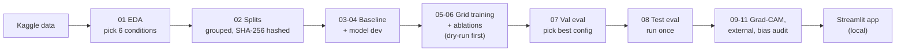
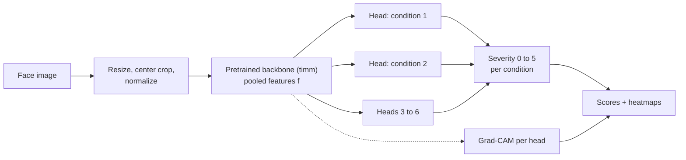

<h1 align="center"></h1>

Multi-condition facial skin grading: one face photo in, ordinal severity scores (0 to 5) for six facial skin conditions out, with a Grad-CAM heatmap per condition showing which facial region drove each score.

> **Disclaimer.** Skin Severity Grader is an early screening aid built for academic research. It is **not** a medical device and does not diagnose disease. Consult a dermatologist for any clinical decision.

---

## Why

A face rarely has only one skin problem. Single-label classifiers miss co-occurring conditions and their different severity levels. Skin Severity Grader estimates several conditions jointly from one image with a shared backbone and independent heads, and exposes its reasoning through per-head Grad-CAM.

## Pipeline

Training and evaluation run in Kaggle notebooks (T4 GPU), only the demo app runs locally. The test split stays untouched until `08_evaluation_test`.



## Architecture

Per-image inference path inside the model:



- **Backbone:** ImageNet-pretrained, loaded through `timm`, classifier removed (`num_classes=0`).
- **Heads:** one small head per condition, independent parameters.
- **Loss:** masked sum of per-head losses (missing labels ignored). Modes: `mse` regression, `wce` class-weighted cross entropy, optional `corn` ordinal.
- **Baseline:** single-output ResNet-18 trained on acne only with unweighted CE.

## Data Used

| Dataset                                      | Role                           | Source                                                                                            |
| -------------------------------------------- | ------------------------------ | ------------------------------------------------------------------------------------------------- |
| Facial Skin Analysis and Type Classification | Train / val / test             | https://www.kaggle.com/datasets/killa92/facial-skin-analysis-and-type-classification              |
| ACNE04-v2                                    | External eval (acne head only) | https://www.kaggle.com/datasets/karmagames/acne04-v2 , https://github.com/AIpourlapeau/acne04v2   |
| Skin Defects (acne, redness, eye bags)       | Sanity check                   | https://www.kaggle.com/datasets/trainingdatapro/skin-defects-acne-redness-and-bags-under-the-eyes |
| SCIN                                         | Skin-tone audit (eval only)    | https://github.com/google-research-datasets/scin                                                  |

Datasets are **not** redistributed in this repo. Limits of each dataset and what they can and cannot prove are listed in `PRD.md` Section 5.

## Repository Layout

```
multi-condition-skin-grading/
├── README.md
├── requirements.txt            # reference list of every package used across notebooks
├── notebooks/                  # each notebook is self-contained and runs top-to-bottom on Kaggle
│   ├── 01_eda.ipynb                       # Phase 1: audit + condition selection
│   ├── 02_splits.ipynb                    # Phase 2: leak-safe split + split_manifest.json
│   ├── 03_baseline_resnet18.ipynb         # Phase 3
│   ├── 04_model_dev.ipynb                 # Phase 4: multi-head model + losses, sanity-checked on
│   │                                       # synthetic data (CPU, no GPU needed) — the canonical
│   │                                       # version of these cells, copied into notebooks below
│   ├── 05_multihead_<backbone>_<loss>.ipynb   # Phase 5, one per grid cell (6 notebooks)
│   ├── 06_ablations.ipynb                 # Phase 6
│   ├── 07_evaluation_val.ipynb            # Phase 7: metrics, bootstrap CIs, figures (validation)
│   ├── 08_evaluation_test.ipynb           # Phase 8: the one-time locked test evaluation
│   ├── 09_gradcam.ipynb                   # Phase 9
│   ├── 10_external_eval.ipynb             # Phase 10 (ACNE04-v2, Skin Defects)
│   └── 11_bias_audit_scin.ipynb           # Phase 11
├── app/                         # the only code that isn't a notebook — runs locally, not on Kaggle
│   ├── streamlit_app.py         # Phase 12 demo; loads a checkpoint downloaded from Kaggle
│   └── infer.py                 # Phase 12 CLI: image or folder in, scores out
├── data/
│   └── splits/                 # train.csv, val.csv, test.csv, split_manifest.json —
│                                # produced by 02_splits.ipynb on Kaggle, downloaded and
│                                # committed here so every later notebook reads the same split
└── outputs/                    # gitignored locally: figures/tables downloaded from Kaggle for the report
```

There is deliberately no `src/` package. Kaggle is the experiment environment (separate from this GitHub repo, which is the submission/documentation archive), so every notebook is self-contained: it installs what it needs, redefines the small pieces it depends on (seeding, device resolution, dataset class, model, losses), and runs independently. This trades some duplication across notebooks for simplicity — there is no package to keep in sync with a separate execution environment. The one exception is `app/streamlit_app.py`, which cannot run as a notebook and must therefore contain its own copy of whatever model class definition matches the checkpoint it loads.

## Setup

Nothing to install locally to run experiments — training happens on Kaggle. `requirements.txt` lists every package used across notebooks; each notebook's first cell installs only what Kaggle doesn't already provide (Kaggle's base image ships `torch`, `numpy`, `pandas`, `scikit-learn`, `matplotlib`, `seaborn`, `tqdm`; a notebook typically only needs to add `timm`, `albumentations`, `pytorch-grad-cam`, `iterative-stratification`, and `imagehash`).

To run the Streamlit app locally:

```bash
python -m venv .venv && source .venv/bin/activate
pip install -r requirements.txt
streamlit run app/streamlit_app.py
```

## Running on Kaggle

1. Create a Kaggle Notebook. **Settings → Accelerator → GPU** (T4 x2 or P100), and enable internet access (needed for the pip-install cell and for `timm` to fetch ImageNet-pretrained weights).
2. **Add Data** and attach whichever dataset(s) that notebook needs:
   - `killa92/facial-skin-analysis-and-type-classification` — training/val/test
   - `karmagames/acne04-v2` — external eval, acne head only
   - `trainingdatapro/skin-defects-acne-redness-and-bags-under-the-eyes` — sanity check
   - SCIN is not on Kaggle; it must be fetched separately per the [SCIN GitHub README](https://github.com/google-research-datasets/scin) and uploaded as a private Kaggle dataset if needed.
     Kaggle mounts each at `/kaggle/input/<dataset-slug>/`.
3. Copy the matching notebook from `notebooks/` into the Kaggle notebook and run it top to bottom.
4. Kaggle sessions are time-limited and can be interrupted — every training notebook checkpoints every epoch and can resume from the last checkpoint in `/kaggle/working/`.
5. Download the notebook's outputs (`/kaggle/working/`: checkpoints, figures, `split_manifest.json`, prediction parquet files) via Kaggle's Output panel, and copy the ones that belong in git (`data/splits/*.csv`, `split_manifest.json`, small figures/tables for the report) back into this repo.

## Usage

Run the notebooks in this order (matches the phases in `agent.md`):

1. `01_eda.ipynb` — audit the raw dataset, confirm the label schema against what the proposal assumes, apply the condition-selection rule (PRD §7.1). Stop at the Phase 1 Gate before fixing the final 6 conditions.
2. `02_splits.ipynb` — pHash-grouped, multilabel-stratified 70/15/15 split. Produces `data/splits/{train,val,test}.csv` and `split_manifest.json` (with a SHA-256 per file) — download and commit these; every later notebook verifies against this hash and refuses to run on a mismatch.
3. `03_baseline_resnet18.ipynb` — single-output ResNet-18 baseline. Has a dry-run cell (one batch forward/backward, 50-step overfit check, timing/memory estimate) that must be reviewed **before** running the full-training cell.
4. `04_model_dev.ipynb` — multi-head model and losses, sanity-checked on synthetic data (CPU only).
5. `05_multihead_<backbone>_<loss>.ipynb` — one notebook per cell of the {EfficientNet-B0, ResNet-50, ConvNeXt-Tiny} × {MSE, WCE} grid. Same dry-run-before-full-run discipline.
6. `06_ablations.ipynb` — single-task vs multi-task, fine-tuning strategy, imbalance handling.
7. `07_evaluation_val.ipynb` — metrics, bootstrap CIs, and report figures on validation, computed from saved `predictions_{split}.parquet` files.
8. `08_evaluation_test.ipynb` — the one-time locked test evaluation.
9. `09_gradcam.ipynb`, `10_external_eval.ipynb`, `11_bias_audit_scin.ipynb` — interpretability, cross-dataset, and bias analysis.
10. `app/streamlit_app.py` — run locally against a checkpoint downloaded from Kaggle: `streamlit run app/streamlit_app.py`.

Each training notebook logs per-epoch metrics (total + per-head loss, per-head val QWK/MAE/macro-F1, LR, epoch time) to a CSV in `/kaggle/working/` and plots them inline with matplotlib at the end of the run — simpler and more reliable on Kaggle than TensorBoard, whose logs don't survive past the session unless exported manually. Weights & Biases remains available as an opt-in for anyone who wants metrics to persist automatically across Kaggle sessions.

## Results

Filled in after Phase 7. Test metrics are reported as mean ± std over 3 seeds, with 95% bootstrap CIs for the best model.

| Models                     | Loss      | Mean QWK | Mean MAE | Acne QWK |
| -------------------------- | --------- | -------- | -------- | -------- |
| ResNet-18 single-output    | CE        | –        | –        | –        |
| EfficientNet-B0 multi-head | MSE / WCE | –        | –        | –        |
| ResNet-50 multi-head       | MSE / WCE | –        | –        | –        |
| ConvNeXt-Tiny multi-head   | MSE / WCE | –        | –        | –        |

## Limitations

- Few samples at high severity levels for several conditions.
- ACNE04-v2 validates only the acne head, on a different grading scale.
- SCIN has no severity labels; the skin-tone audit uses proxy metrics.
- Dark skin tones are underrepresented in the training data.

## Team

Dian Rakhmawati Lestari
